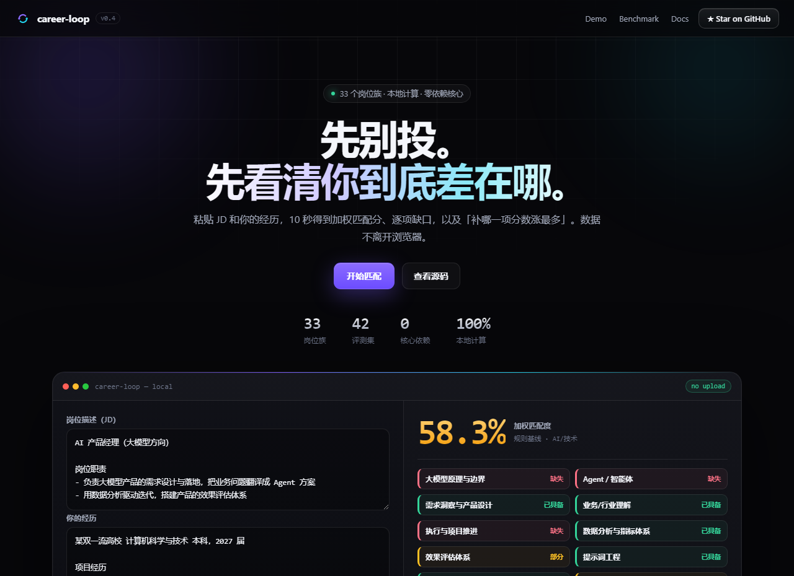
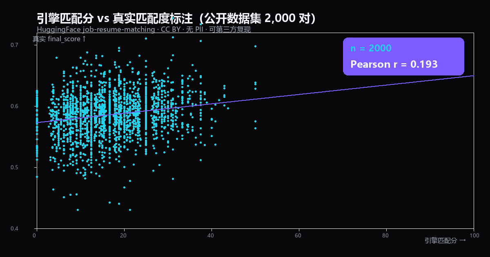
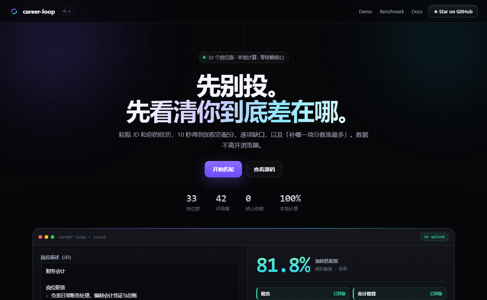

# Career-Loop

<p align="center">
  
  <b>Don't apply yet. First find out exactly what you're missing.</b>
  
  <br><br>
  
  Paste a JD + your experience → a match score, a per-item gap list, and
  <i>"which one skill raises my score the most?"</i>
  
</p>

<p align="center">
  
  <a href="https://github.com/jian935/career-loop/stargazers"></a>
  
  
  
  
  
  
  
  
  
</p>

<p align="center">
  
  <a href="#quick-start">Quick start (CLI)</a>
  
  &nbsp;·&nbsp;
  
  <a href="docs/index.html">Try it in the browser</a>
  
  &nbsp;·&nbsp;
  
  <a href="#the-demo-video-2m15s">Demo video (2m15s)</a>
  
  &nbsp;·&nbsp;
  
  <a href="README.md">中文</a>
  
</p>

<p align="center">
  
  
  
</p>

> Most job-matching tools hand you a number and walk away.
> **career-loop also asks you to check whether that number was right** — it computes a
> correlation between your match score and what actually happened when you applied.

**career-loop** is an open-source tool for job seekers in **any** field (new grads
especially). It takes a job description and your experience, and returns a **match
score + a gap list**. You then apply with it, log the real outcome (read / interview /
offer), and feed those outcomes back. Finally you get a **Pearson r** telling you
whether the score had any predictive power at all.

The capability vocabulary is not AI-only. It covers AI/tech, general skills
(communication, execution, writing…), and **69 job families** — product, marketing,
sales, finance, design, operations, HR, education, healthcare, legal, supply chain,
manufacturing, backend, frontend, QA, DevOps, banking, consulting, media, gaming,
customer service, retail, energy, automotive, agriculture, research, social work,
sports, and more. Requirements the vocabulary doesn't cover are **never dropped**:
they fall back to text similarity, flagged for manual review.

If the score holds up, keep using it to prioritise applications. If it doesn't,
that means the model was guessing — and you now have the data to fix the weights.

```
   Job description  ──┐
                       ├─►  [Matching engine] ─►  predicted score + gap list
   Your experience  ──┘        (with source quotes)          │
                                                            │
                    [Application log] ── real outcomes fed back
                                    │
                                    ▼
                           [Calibration] ──  r = corr(score, outcome)
                                    │
                                    ▼
              reweight capabilities / re-rank applications / target the right gap
```

---

## What it does — and what it deliberately doesn't

**Does:**

- Splits a JD into capability items and compares each one against your experience,
  producing a **match matrix with the original text quoted as evidence**.
- Tells you **which single gap raises your score the most** (counterfactual), and
  **which job to apply to first** when you have a whole batch in front of you.
- Logs applications and real outcomes, then checks the score with **Pearson r**.
- Covers 69 job families; anything outside the vocabulary is still judged, not dropped.

**Doesn't:**

- Doesn't auto-apply, doesn't scrape job boards, doesn't write your CV or cover
  letter — that's what career-ops / Resume-Matcher style projects are for.
- Doesn't promise "apply and you'll get an interview". The score is an estimate,
  not an admission prediction.
- **Doesn't claim a real-world accuracy rate.** The bundled eval set is a
  regression lock, and `r` is meaningless without the sample size next to it.
- Doesn't upload your data. Storage is a local SQLite file; in LLM mode the only
  thing leaving your machine is the request to the provider *you* configured.

---

## The demo video (2m15s)

A narrated walkthrough of the full loop: match → decide → collect → evaluate →
calibrate → close the loop.

[▶ Play / download the demo video (MP4, 2m15s)](docs/career-loop-demo.mp4)

---

## Try it without installing anything

- Open [`docs/index.html`](docs/index.html) in a browser: pure front-end, paste a JD
  and your experience, the score is computed locally, **nothing is uploaded**.
- `python scripts/demo_cli.py` — offline preview of the core engine, no API key needed.
- Deploy to GitHub Pages: `bash scripts/publish_github.sh` (create repo → push →
  enable Pages → self-check), or set it up by hand via
  `Settings → Pages → Source: Deploy from a branch → Branch: main, Folder: /docs`.

---

## Why this exists

Applying for an AI product or Agent role, the anxious part is this: **"I know
Python" and "I built an Agent" are worth wildly different amounts in different JDs**
— and you never find out which, because you apply blind.

Existing "resume matchers" are one of two things: a black box that hands you an 80
without telling you why, or a one-shot comparison that never tells you whether the
last time it called you a strong match, you actually got an interview.

career-loop's differentiator is one sentence: **the match score is falsifiable.**
It computes a correlation coefficient and answers *"is my matching logic actually
predicting outcomes?"* — which is exactly the "build an evaluation system, validate
the product with data" language that keeps showing up in senior engineering job
descriptions. This repo is the smallest honest implementation of that idea.

---

## How it differs from the usual toys

| Typical resume matcher                | career-loop                                          |
| ------------------------------------- | ---------------------------------------------------- |
| Black-box score, no justification     | Every capability carries **the JD's own words + your own words**, auditable line by line |
| One-shot score, then forgotten        | **Closed loop**: apply → log → calibrate; the score improves with real data |
| Claims "95% accuracy"                 | Ships a **60-row control set** as a regression lock and says plainly that it locks *logic*, not real-world accuracy; real end-to-end validation is a separate public-dataset number (r = 0.193) |
| Needs a big-model API                 | **Zero-dependency rule baseline** out of the box; an OpenAI-compatible key upgrades it to semantic matching, and without a key it falls back silently |

---

## The six-step loop

1. **Add** — `add-jd` / `add-profile`, or `collect --dir` to bulk-import raw JDs
   from a folder (strips job-board noise, dedupes by title).
2. **Match** — `match` splits the JD into capability dimensions and compares each
   against your experience: match matrix + weighted score + gap list, every gap
   quoting the JD's original text.
3. **Decide** — `recommend` ranks a batch of JDs for you; `demand` aggregates
   *"which capabilities are most in demand, and which one should I fix first?"*
4. **Apply** — `apply` records an application and computes the predicted score;
   `status` shows all of them.
5. **Log** — `log` writes the real outcome (replied / interview / offer) back.
6. **Calibrate** — `calibrate` computes `r` between score and outcome. High → keep
   trusting it for prioritisation. Low → the weights are wrong, fix them with the
   data and go back to step 2.

That's the difference from a one-shot scorer: **every turn of the loop makes the next
turn better.**

---

## Feature overview

- **Matching engine (any job family)** — JD × experience → capability matrix
  (full / partial / missing), each item quoting its source text.
- **Weighted score** — `score = Σ(weight × status) / Σ(weight)`, partial counts 0.5.
- **Gap ranking** — sorted by `weight × severity`, so a heavy missing requirement
  can't be averaged away.
- **Evaluation (three independent pillars)** — see below.
- **Job-family detection** (`domains`) — `rules` / `llm` / `auto` / `blend` backends.
  `blend` (default) puts the model's first pick first and fills in with the
  vocabulary: **86.0% → 93.4%** on 1,838 real Chinese JDs.
- **The browser demo can use the model too** (v0.8.21) — run `career-loop llm-proxy`
  and paste the printed address + token into the "接入 LLM 族识别" panel in the
  Chinese-JD lab. The key stays on your machine (this sidesteps CORS and keeps the
  key out of the page), and the web demo uses the **exact same closed-set prompt**
  as the CLI — generated by `sync_web_vocab.py`, verified character-by-character by
  `scripts/cross_engine_llm_check.py`.
- **Calibration** (`calibrate`) — Pearson r + 20-bucket positive-feedback rate.
- **Two-way matching** (`recommend`) — rank JDs for a profile, and compute
  *"which one skill unlocks the most jobs?"*
- **Counterfactual explanation** (`whatif`) — *"if I had X, my score would go from
  A to B"*, turning advice into a number.
- **Internship direction recommender** (`intern`) — 10 directions ranked by target
  fit + score, with a term timeline (day internship → summer → autumn → spring).
- **Industry-wide scan** (`scan`) — profile × a batch of jobs → cross-industry fit
  ranking, target-level down-weighting (intern/junior/mid/senior).
- **JD collection & demand heatmap** (`collect` / `demand`).
- **Local storage** — SQLite for candidates / JDs / applications, zero external deps.
- **Daily application list** (`daily`, v0.8.23) — a batch of JDs becomes today's
  to-do list: role + score + **cheapest fix (with the resulting score)** + **due date**;
  exportable to a Markdown checklist, CSV, or **ICS** (imports into calendar/task apps).
  Due dates are heuristic and always state their source. **The web demo has it too**
  ("③ Sort by due date" in the batch section re-ranks by deadline and exports all three
  formats) — the same rule set is generated into the page's JS by `sync_web_vocab.py`
  and diffed case-by-case by `scripts/cross_engine_daily_check.py` (which has a
  `--self-test` mode proving injected divergences are actually caught).
- **Optional dashboard (v0.8.22)** — `streamlit run career_loop/dashboard.py`:
  application funnel, score × outcome scatter **with a 95% CI for r**, and a gap
  ranking. Without real data it reads a fabricated sample and says so in red.

---

## Install

Python 3.10+. The core (match / eval / calibrate / storage) has **zero third-party
dependencies**; only the dashboard needs `streamlit`.

```bash
git clone https://github.com/jian935/career-loop.git
cd career-loop
pip install -e .            # installs the `career-loop` command
# optional dashboard
pip install streamlit
```

---

## Optional: bring your own LLM

The rule baseline runs with no key. With an OpenAI-compatible key configured,
`match` / `whatif` / `apply` / `recommend` / `add-jd` upgrade to semantic matching
and fall back to the rules on any failure.

```bash
export OPENAI_API_KEY=sk-...                 # or DEEPSEEK_API_KEY
export OPENAI_BASE_URL=https://api.deepseek.com
export OPENAI_MODEL=deepseek-flash
career-loop doctor                           # shows whether the key was picked up
career-loop match --jd ... --profile ...     # output shows mode: llm
```

- You can also put those three lines in a `.env` at the project root (gitignored;
  the CLI reads it on start). Copy `.env.example` to get started.
- **LLM mode is not bound by the vocabulary** — roles with no preset family
  (tea master, vet, customs broker…) get self-created `custom:` / `llm:`
  capability items, so new jobs need no code change.
- **Job-family detection has an optional LLM backend** too:
  `career-loop domains --file jd.md` (default `blend`). On the same public Chinese
  dataset: any-in accuracy **86.0% → 93.4%**, top-1 **56.6% → 73.5%**, the
  `service` family **52% → 78%**. `--backend llm|auto|rules` switches backends;
  without a key (or on any API failure) it falls back to the rules.
  The **main pipeline never calls the LLM** — match / reflow / calibrate stay
  rule-only so the calibration `r` stays reproducible offline.
- **Want the browser demo to use the model as well? Start a local proxy** (v0.8.21):
  ```bash
  career-loop llm-proxy        # prints the address and a token; Ctrl-C to stop
  ```
  then paste both into the "接入 LLM 族识别" panel in the Chinese-JD lab. Browsers
  can't call model providers directly (CORS), and an API key has no business
  sitting in a web form — this proxy runs on `127.0.0.1` and keeps the key local.
  It carries a one-time token (so another local page can't spend your key), binds
  to loopback only, caps the request body at 200KB, and **refuses to let the page
  choose the model** (so nothing can redirect you to a pricier one).
- Results are cached in `~/.career_loop/llm_cache` (keyed by JD/profile hash), so
  re-analysing the same JD doesn't cost twice.
- Force the rules with `--no-llm` (or `CAREER_LOOP_NO_LLM=1`);
  `CAREER_LOOP_NO_CACHE=1` disables caching only.
- Provider comparison (base URLs, free tiers, prices) → [docs/providers.md](docs/providers.md).

---

## Quick start

### 1) A match report (no key required)

```bash
career-loop match \
  --jd examples/jds/jd_backend_pm.md \
  --profile examples/profile_me.md \
  --out report.md --json
```

```
Match 88.5%  ·  mode rule  ·  report written to report.md
```

Every capability in the report carries a status icon, the JD's original wording, the
quote from your own experience, and a concrete suggestion for closing the gap.

### 2) Score the engine itself (eval)

```bash
career-loop eval --data data/eval_sample.jsonl --badcases badcases.jsonl
```

```
Eval set 60 rows   rule-baseline agreement 1.0
Per capability: python 1.0 / agent 1.0 / rag 1.0 / ... (16 capabilities, all 1.0)
No bad cases.
```

> ⚠️ **Honest note:** that 1.0 is on a **hand-built, deliberately edge-case-laden**
> 60-row set. Its job is to **lock the matching logic against regressions** — it is
> *not* a claim of 100% real-world accuracy. Real accuracy has to be approached with
> the calibration loop below and with more real applications; the public-dataset
> end-to-end number is r = 0.193 (see `docs/benchmark.md` §2.2).

### 3) Calibration: is the score actually predictive?

**Demo (how to read the report):**

```bash
career-loop calibrate --data data/demo_applications.jsonl
```

```
n = 29    overall positive-feedback rate 0.448
Pearson r (score ↔ outcome) = 0.694

Bucketed positive-feedback rate:
    0-20   n=0    rate=0.0
   20-40   n=4    rate=0.0
   40-60   n=7    rate=0.143 ####
   60-80   n=10   rate=0.5   ###############
  80-100  n=8    rate=0.875 ##########################

Verdict: moderate-to-strong correlation (|r| ≥ 0.4). The score does predict outcomes…
```

> ⚠️ The 29 rows here are **synthetic demo data**; r = 0.694 only shows how to read
> the module. It is **not a real statistic**.

**Real-data check (reproducible):** on the public `job-resume-matching` dataset
(1,167 real JDs + 9,544 real résumés + 122,560 real match labels):

- **Family-identification accuracy 93.6%** (1092/1167 English JDs: FINANCE 96.6% /
  HR 99.5% / BUSINESS-DEVELOPMENT 100% / IT 93.3% / SALES 78.4%)
- **Chinese family identification 86.0%** (1,838 real Chinese JDs from the public
  `ngtranai09/china_job` dataset, covering 35+ families). The jump from 77.8% to
  86.0% came from **diagnosing data-source artefacts first**: a job-board source
  declaration containing "招聘" and an anti-fraud disclaimer containing "证照" were
  causing false hits across the `hr` and `admin` vocabularies. Every new keyword
  had to pass a **word→family precision ≥ 60%** pre-check, and gains had to show up
  on **both** a dev and a hold-out split (overfitting guard). Chinese is genuinely
  harder (300+ sub-industries, one JD spanning several families, short JDs with
  little signal), so the Chinese number is reported **next to** the English one, not
  in place of it. The families that stay weak (`service` 52%, `product` 70%) and the
  `hr` vocabulary's 5% precision are written down in `docs/evidence.md` §1.4 — not
  hidden. A dedicated round on `service` / `project_mgmt` (§1.5) tried four
  different approaches and concluded they **cannot be fixed with keywords**; the
  evidence chain is published. v0.8.17 therefore added a **second opinion** from a
  semantic model: the rule+LLM blend (`blend`) measures **93.4%** on the same
  dataset (service 52%→78%, project_mgmt 70%→83%). The LLM alone is *not* a
  replacement — it misses consulting / implementation / pre-sales roles. Process
  and limits: `docs/evidence.md` §1.6.
- **Pearson r = 0.193** between the engine score and the dataset's `final_score`
  (2,000 real pairs, weak positive)

A low-but-positive r is what you'd expect here: the engine is a **rule-based
keyword baseline** while `final_score` is a **multi-dimensional semantic match** —
same direction, limited explanatory power. Full method, the real bugs that
test-driven fixing uncovered, and the honest limits:
[`docs/real_eval_report.md`](docs/real_eval_report.md).

**The evidence wall** (the one page to show a reviewer or an interviewer): both
numbers above, a real scatter plot, the three-step loop, and **the author's own
failure interval** → [`docs/evidence.md`](docs/evidence.md).

**The author's own real applications (the failure interval is public too):**
recomputed with the current engine on my 40 private applications, the early-stage
Pearson r is **-0.059** (negative); on the same-source 50-row sample the
terminal-stage r is **0.03**. Those are ugly numbers — and they are the most
convincing part of the project, because **a tool that publishes its own failure
interval is the only kind that deserves the word "falsifiable"**. The same data
sits in the demo's evidence wall (aggregates only, no CVs, no company names).

**A full de-identified reflow report**: 50 real Chinese JDs + real feedback
outcomes, rendered as a complete markdown report (per-row detail table, directional
comparison, boundary statement) → [`docs/reflow_sample.md`](docs/reflow_sample.md).
Company names are replaced by codes and notes are compressed into attribution
labels — but **attribution is computed *before* de-identification**, so
de-identifying cannot change the conclusion. The long-form retrospective (including
the whole "the real data slapped me in the face" story, the honest limits, and what
the data taught me about job hunting): [`docs/retro.md`](docs/retro.md).
The idea in one line: **a score that dares to be disproven is the only kind worth
trusting when it says you are a good match.**



```bash
python scripts/real_eval_family.py                        # family accuracy on real JDs
python scripts/real_eval_calibrate.py --n 2000 --seed 7    # real r (2,000 pairs)
python scripts/real_eval_scatter.py  --n 2000 --seed 7     # redraw docs/evidence-scatter.png
python scripts/gen_eval.py                                 # regenerate the 60-row control set
```

### 4) The real closed loop: apply → log → calibrate

```bash
career-loop init                              # local DB (default ~/.career_loop/loop.db)
career-loop add-profile --name me --file examples/profile_me.md
career-loop add-jd      --file examples/jds/jd_backend_pm.md
# note the ids printed, e.g. profile=1, jd=1
career-loop apply --jd-id 1 --profile-id 1    # record an application, score computed
career-loop status                            # list all applications
career-loop log --app-id 1 --status interview # feed back (also: interview_eliminated / silent)
career-loop calibrate                         # recalibrate on real data
```

**Already have a batch of applications? One command runs the whole loop:**

```bash
career-loop reflow \
  --records examples/reflow_demo_records.csv \
  --profile examples/profile_me.md \
  --mode terminal \
  --out reflow_report.md
```

`reflow` reads an application table (CSV / JSONL / JSON, column names auto-sniffed)
and runs: **read records → score → calibrate r → funnel attribution → directional
comparison → markdown report**, optionally writing back into the local DB with
`--db-write` so `status` / `calibrate` can continue from there.

Two definitions of "positive" **must** be kept apart — mixing them produces
conclusions nobody can explain:

| `--mode`   | Counts as positive                                   | Question it answers                          |
| ---------- | ---------------------------------------------------- | -------------------------------------------- |
| `terminal` (default) | **an offer only**                          | Does the score predict getting the job?      |
| `early`    | HR replied / interested / passed screening / interview | Does the score predict "will HR engage me"? |

The report also does one extra thing: **when r is low, it compares the score
distributions of the positive and negative groups first.** If the two overlap, the
outcome was unrelated to fit in the first place; if they separate but r isn't
significant, you simply need more samples.

The bundled sample data (`examples/reflow_demo_records.csv`) is **fabricated** — it
only demonstrates how the command works. See
[`examples/reflow_demo_README.md`](examples/reflow_demo_README.md) for why a
synthetic set always produces a flattering r and why that number means nothing.

### 5) Profile → JDs: what to apply to, what to fix (two-way matching)

```bash
career-loop recommend \
  --profile examples/profile_me.md \
  --jds examples/jds \
  --threshold 70 --top 5
```

```
Your experience × 3 JDs, ranked by match score:
  1.  88.5%  Backend Engineer (campus hiring)
  2.  75.0%  AI Product Manager (campus / trainee program)
  3.  61.4%  Agent Application Engineer (intern / campus)

Adding these unlocks the most JDs above the 70% line (best value gaps):
  + Agent / intelligent agents: unlocks 1 more JD
      · Agent Application Engineer (intern / campus)
  + Function calling / tool use: unlocks 1 more JD
      · Agent Application Engineer (intern / campus)
```

That second block *is* the answer to "what project should I build next": get Agent
and function calling demonstrable and you become eligible for one more job.

### 6) Bulk JD collection + demand heatmap

```bash
career-loop collect --dir examples/raw_jds --report demand.md
career-loop demand --profile examples/profile_me.md
```

### 7) Dashboard (optional): funnel + scatter with CI + gap ranking

```bash
career-loop dashboard                                            # auto-picks a source
career-loop dashboard --records ledger.csv --profile my_cv.md    # your own data
career-loop dashboard --port 8600
```

Three panels, each labelled with its own definition so screenshots never lose context:

- **Funnel** — hard counts that depend on no score at all. Verify this layer first,
  *then* talk about correlations.
- **Calibration scatter** — one dot per application, a per-bucket positive-rate line on
  top, and a **95% confidence interval for `r`** (paired bootstrap, fixed seed →
  reproducible). **A single r is not falsifiable**: the bundled demo (n = 12) prints
  r = +0.293 while its interval is `[-0.280, +0.854]` — it spans zero, meaning this
  data cannot rule out "the score has nothing to do with the outcome".
- **Gap ranking** — which capability would unlock the most JDs if you added it
  (same algorithm as `recommend`).

Switch aims in the sidebar (early signal vs. final offer) and everything recomputes.
The demo data is **fabricated** — the board flags it in red. It is not evidence.

> Because the dashboard is the only part with an optional third-party dependency, it
> ships `scripts/smoke_dashboard.py`: AppTest runs the app headless (no browser),
> asserts no exception and that key elements are present; `--self-test` proves the
> checker itself can fail.

### 8) Daily application list: what to send today, and what to fix first

```bash
career-loop daily --profile profile_me.md --jds my_shortlist --top 5
career-loop daily ... --out today.md                 # Markdown checklist
career-loop daily ... --out today.csv --format csv   # spreadsheet / Notion
career-loop daily ... --out today.ics --format ics   # calendar & task apps (with due dates)
```

Every row carries four things — **miss one and it stops being a list and becomes a
leaderboard**: the role, the score, the **cheapest fix** (actually recomputed through
`counterfactual`, so it reads "66.7% → 76.2%" rather than "you should improve X"), and
the **due date**.

```
 1.  66.7%  Agent Application Engineer (intern / new grad)   due 2027-02-28 (from the JD)
      add "Agent" → 76.2%  (+9.5)
```

Ordering: roles with a due date first, earliest first; the rest after, by score desc.
Each line also says *why it made today's list* (days left, what the top fix buys you).

> ⚠️ **Due dates are heuristic.** They are only picked up near cues like
> "deadline" / "截止" / "有效期至", and every row states where it came from
> (from the JD / `--due` fallback / not given). **Check the original posting before
> relying on it.** A JD that says "until the role is filled" is reported as *no date*
> rather than a guess.
>
> A real sample run (demo JDs + the sample profile): [`docs/daily_sample.md`](docs/daily_sample.md).

---

## Supports any job family (not just AI)

Four layers of vocabulary, and **nothing outside it is thrown away**:

1. **AI / tech** — Python, RAG, Agent, function calling, frameworks, AI coding tools,
   evaluation…
2. **General skills** — communication, execution, problem solving, self-directed
   learning, writing, customer orientation, leadership, languages, office software.
3. **Job families (69 families / 180 capability items)** — AI specialisations (12),
   business & management (16), R&D & engineering (9), finance (4), media &
   entertainment (4), services & retail (5), manufacturing / energy / agriculture (4),
   research & public sector (5), plus product, design, operations, education,
   healthcare, legal, manufacturing, guiding & commentary.
4. **Occupation-classification skeleton** — families can be mapped onto the 8
   top-level classes of China's Occupation Classification Dictionary; run
   `career-loop occupations` to recompute the reconciliation table yourself
   (which mid-classes have a vocabulary, which are blank). Of 75 test roles,
   the 69 with a built vocabulary reach **100% family-identification rate**
   with a 3% fallback rate (`scripts/coverage.py`).
   > Three denominators, and the only one worth quoting is the first one:
   > **coverage 62/79 = 78%** — measured against all 79 mid-classes in the
   > Dictionary. The other two are internal bookkeeping: completeness 62/76
   > (measured against the mid-classes *this repo transcribed, with codes*) and
   > enumeration rate 76/79 (admitting that even the list itself is incomplete).
   > An earlier version hand-picked the 39 mid-classes it happened to support and
   > reported "100% + 49%" — both true, but **a percentage whose denominator you
   > chose yourself is not evidence of coverage**.

   A real run of that table: [`docs/occupation-coverage.md`](docs/occupation-coverage.md).
   The web page's "Occupation classification · coverage reconciliation" block renders
   the very same numbers (computed here, pushed to the page — the page deliberately
   carries no algorithm), so it **cannot** drift from the CLI; that too is locked by
   the cross-engine check above.
5. **Custom fallback** — a requirement that no vocabulary hits is kept verbatim and
   compared by text similarity, marked *"needs manual confirmation"*.

<p align="center">
  
  
  
</p>

Measured: an accounting JD is identified as the **finance** family at **81.8%**, with
"intermediate accounting title" as the only remaining gap; a sales JD picks up
customer development / negotiation / CRM; a design JD picks up visual / brand /
design tooling. Click "try another example" in the browser demo to see both an AI
role and an accounting role.

> The rule baseline is keywords + text similarity — good enough across job families,
> not fine-grained. For higher-quality semantic matching, plug in any
> OpenAI-compatible LLM (it falls back to the rules automatically on failure).

---

## The evaluation system (three independent pillars)

| Pillar | What it is | Result |
| --- | --- | --- |
| **① Control regression set** | `data/eval_sample.jsonl` — 60 hand-built rows across 16 capabilities (full / partial / missing + coverage and edge cases). Its job is to **lock the matching logic** against regressions. | agreement **1.0**, no bad cases |
| **② Public English dataset** | `job-resume-matching` on HuggingFace — 1,167 real JDs + 9,544 real résumés + 122,560 real labels | family accuracy **93.6%**, score ↔ label **r = 0.193** |
| **③ Public Chinese dataset** | `ngtranai09/china_job` — 8,674 real Chinese JDs | family accuracy **86.0%** (rules) / **93.4%** (rule+LLM blend) |

Pillar ③ also includes **45 real Chinese JD lines hand-annotated** across 20
capabilities (`data/eval_real_jd.jsonl`) plus a **10,613-line hold-out** that was
never annotated. A context guard on over-generic words lifted hold-out consistency
from 86.2% to **100.0%** — a **+13.8 point** contribution, measured on the hold-out
set (not the annotated one), so it is not overfitting.

The full method, the failed approaches, and the numbers we deliberately do *not*
report are in [`docs/evidence.md`](docs/evidence.md) and
[`docs/benchmark.md`](docs/benchmark.md).

---

## Repository layout

```
career-loop/
├── career_loop/
│   ├── matching/        # engine: schema (vocabulary) / extract / match / llm / family_llm (LLM family backend) / boilerplate / render
│   ├── store.py         # SQLite storage: candidates / JDs / applications
│   ├── calibrate.py     # Pearson calibration + bucketing + verdict
│   ├── eval.py          # labelled eval-set loading + scoring
│   ├── recommend.py     # two-way matching: profile→JD ranking + gap value
│   ├── collect.py       # bulk JD collection + demand heatmap
│   ├── internship.py    # internship direction recommendation + term timeline
│   ├── explore.py       # industry-wide scan: ranking, fit, level down-weighting
│   ├── cli.py           # CLI entry point (init / doctor / add-* / match / whatif / apply / status / log / calibrate / eval / reflow / recommend / collect / demand / intern / scan / dashboard / domains / llm-proxy / daily / occupations)
│   ├── dashboard.py     # Streamlit rendering layer (optional dep; draws only)
│   ├── dashdata.py      # board data layer: funnel / calibration / CI / gaps (zero-dep, tested)
│   ├── daily.py         # daily list: ranking + due-date parsing + md/csv/ics export
│   └── tests/           # 231 unit tests
├── docs/                # zero-install web demo (index.html) + screenshots / GIF / demo video; also the Pages site root
├── data/
│   ├── eval_sample.jsonl        # 60-row control regression set
│   ├── eval_real_jd.jsonl       # 45 hand-annotated real Chinese JD lines
│   └── demo_applications.jsonl  # 29 synthetic rows (calibration demo)
├── examples/
│   ├── profile_me.md            # sample experience
│   ├── jds/                     # cleaned sample JDs
│   ├── daily_jds/               # sample JDs for `daily` (with due dates / "until filled")
│   └── raw_jds/                 # raw JDs with job-board noise (for collect)
└── scripts/
    ├── gen_eval.py              # regenerates the 60-row control set (byte-reproducible)
    ├── smoke_dashboard.py       # headless dashboard smoke test (AppTest), with --self-test
    └── ...                      # eval / collection / calibration / vocab sync / anonymisation audit tools
```

---

## Quality & self-checks

- **231 unit tests** — matching, calibration, storage, recommendation, collection,
  counterfactuals, non-AI generalisation, internship ranking, industry scan and
  level detection, LLM wiring and self-created capabilities, the LLM family
  backend (fallback, auto/blend split, prompt covering every family), `.env`
  parsing, and the CLI `--db` routing (prevents cross-database mix-ups).
- **41 end-to-end CLI audit checks** — happy path + edge cases (invalid ids, empty
  JD, insufficient samples, empty DB, empty directory, duplicate collection,
  illegal states, malformed due dates, occupation reconciliation) + `doctor` + `scan` + all three `daily`
  exports must run and produce non-empty files.
- **Web end-to-end smoke** (`python scripts/smoke_web.py`) — loads the **entire
  `<script>`** of `docs/index.html` into Node and clicks every entry point (18 of
  them: single JD, batch ranking, daily list, three exports, industry scan,
  internships, occupation reconciliation, extraction lab, calibration board).
  It covers what pure-function parity cannot: a page printing `undefined`, or an
  export button throwing. Its `--self-test` requires all four injected breakages
  to be caught.
- **Cross-engine parity** — the browser demo reimplements the rules in JavaScript.
  `scripts/cross_engine_check.py` compares both engines on real Chinese and English
  JDs, capability extraction *and* family identification, and the vocabulary is
  generated from Python by `scripts/sync_web_vocab.py` so the two cannot drift.
- One command: `python -m unittest discover -s career_loop/tests`.
- **CI runs three jobs** — `test` (a 6-cell matrix: ubuntu/windows × py3.10/3.12/3.13,
  including invoking `career-loop` **the way users do**, web-vocabulary parity, three
  cross-engine diffs, and the whole-page smoke), `docker` (real build + three commands
  inside the image), and `ui` (`pip install -e .[ui]` + headless dashboard smoke).
  The dashboard and the Dockerfile used to be "promised but never verified"; both are
  now under automation.

---

## Design trade-offs

1. **Rule baseline first, LLM optional.** It must run, be testable and be falsifiable
   without any key. The LLM is an upgrade when available, and falls back silently.
2. **Evidence is quoted verbatim.** The model is never allowed to "invent" evidence,
   which keeps every row auditable. This is the real difference from a black box.
3. **The eval set is a regression lock, not an accuracy claim.** 60/60 means "the
   logic wasn't broken", not "100% accurate in the real world".
4. **Correlation, not causation.** Calibration answers "does the score move with
   the outcome?", never "you got the interview because your score was high".
5. **Local-first.** Your data lives in your own SQLite and is never uploaded.

---

## Known limitations

- The rule baseline is keyword-based, so heavily paraphrased or implicit phrasing
  can be missed — which is exactly why the LLM mode and the no-key fallback both
  exist.
- The converse also holds: mentioning `LangChain` / `知识库` marks `framework` / `rag`
  as covered even if *"I only did keyword matching, no vector search"*. Treat the
  `demand` coverage as a *relative* prioritisation signal, not a precise profile.
- The Chinese vocabulary's `hr` family still has low precision (~5%): generic
  Chinese soft-skill words cross family boundaries. Documented in
  `docs/evidence.md` §1.4 rather than hidden.
- The Chinese scene is harder than the English one (300+ sub-industries, one JD
  spanning several families, short JDs). Reported side by side, never swapped out.
- Calibration refuses to draw a conclusion below 5 samples (no pretending 2 rows
  are significant).
- Currently Chinese JDs / experience only (the vocabulary was written for the
  Chinese job market).

---

## Contributing

Issues and PRs are welcome — especially vocabulary additions for job families that
aren't covered yet, and failure cases for the weak families listed above.

**If you add or change vocabulary, run all three:**

```bash
python scripts/sync_web_vocab.py        # regenerate the web demo's vocabulary from Python
python -m unittest career_loop.tests.test_core
python scripts/audit.py
```

The repo's bar is high on purpose: a new keyword must not fire on other job
families' JDs, and a tightened keyword needs a matching regression test. Both
rules have burned us before, so both are enforced by tests.

## License

MIT — see [LICENSE](LICENSE).

Data used for evaluation comes from public datasets (`job-resume-matching`,
`ngtranai09/china_job`); your own applications and profile stay on your machine.

## Related projects

| | career-ops / ai-job-search | Resume-Matcher | **career-loop** |
| --- | --- | --- | --- |
| Positioning | full job-hunting agent (scan, tailor CV, track applications) | CV tailoring + ATS scoring | **the verifiable evaluation layer** |
| Stack | Node / CLI / LaTeX | Next.js / FastAPI / Docker | **zero-dependency Python core** |
| Scoring | 1–5 (with a calibrate mode) | ATS 0–100, weights published | **weighted score + quoted evidence + counterfactual + Pearson r** |
| Who it's for | you want the whole pipeline automated | you want to pass an ATS | **you want to know "is this score predictive, and what should I fix?"** |

They solve "get the application finished"; we solve "is this score any good, and
what should I learn next?". Not a replacement — combinable.
