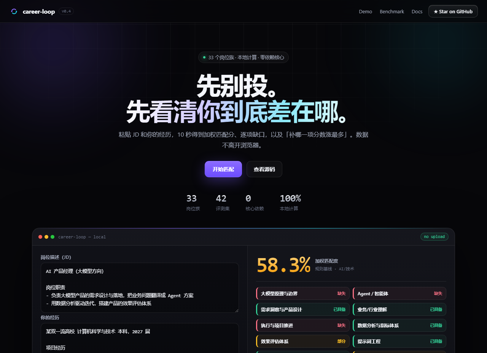
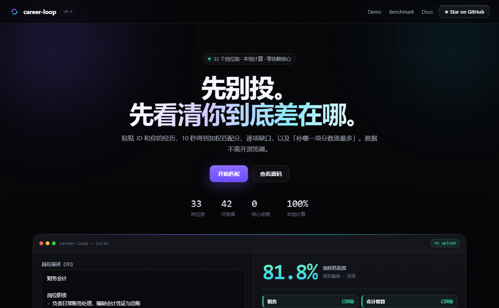
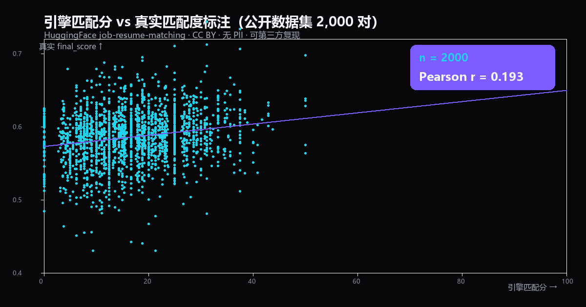

# Career-Loop

<p align="center">
  
  <b>先别投。先看清你到底差在哪。</b>  

  
  粘贴 JD + 经历 → 匹配分 + 逐项缺口 + 「补哪一项分数涨最多」。
  
</p>

<p align="center">
  
  <a href="https://github.com/jian35/career-loop/stargazers"></a>
  
  
  
  
  
  
  
</p>

<p align="center">
  
  <a href="https://jian35.github.io/career-loop/"><b>▶ 在线试用（免安装，浏览器里跑）</b></a>
  
  \&nbsp;·\&nbsp;
  
  <a href="#三分钟演示视频">3 分钟演示视频</a>
  
  \&nbsp;·\&nbsp;
  
  <a href="#快速开始">命令行上手</a>
  
</p>

<p align="center">
  
  
  
</p>

> 把「我到底适不适合这个 AI 岗位」从玄学，变成 **可证伪、可校准** 的数据闭环。
>   
> 市面上大多数工具给你一个分数就走；career-loop 还会用你真实的投递结果，回算「这个分数到底准不准」。

Career-Loop 是一个面向 **所有岗位求职者（尤其应届生）** 的开源小工具：它把一份 JD 和你的经历文本喂给一个匹配引擎，给出**预测匹配分 + 缺口清单**；你拿它去投递，再把真实结果（已读 / 面试 / offer）回流，最后用**相关系数**检验「这个匹配分到底准不准」。

能力词表不只有 AI：AI / 技术、通用能力（沟通、执行、学习……）、65 个岗位族（产品、市场、销售、财务、设计、运营、人力、教育、医疗、法务、供应链、制造、后端、前端、测试、运维、金融、咨询、传媒、游戏、客服、零售、能源、汽车、农林、科研、社工、体育……）都有覆盖；**词表没覆盖的要求也不会被丢掉**，会按文本相似度逐条判断。

准，就继续信它做投递优先级；不准，就说明模型在猜，该反过来用真实数据修权重。

```
   JD（岗位要求）  ──┐
                    ├─►  [匹配引擎] ─►  预测匹配分 + 缺口清单（带原文证据）
   经历（你的简历） ─┘        │
                             │
                     [投递记录] ── 回流真实结果（replied / interview / offer）
                             │
                             ▼
                    [校准模块] ──  r = corr(匹配分, 真实结果)
                             │
                             ▼
              调整能力权重 / 重排投递优先级 / 定位最该补的缺口
```

---

## 它做什么 / 它不做什么

**做：**

- 把 JD 拆成能力项，逐条和你的经历比对，给出**带原文证据**的匹配矩阵。
- 告诉你**补哪一项分数涨最多**（反事实），以及一批岗位里**先投哪个**。
- 记录投递与真实结果，用 **Pearson r** 检验「这个分数到底准不准」。
- 覆盖 AI 各细分 + 工商管理大类 + 研发工程 / 金融 / 传媒 / 服务零售 / 制造能源 / 科研公共等 65 个岗位族；词表外的要求走兜底，不丢弃。

**不做：**

- 不自动投递、不爬招聘网站、不生成简历 / 求职信——这些交给 career-ops、Resume-Matcher 一类项目。
- 不承诺「投了就有面试」；分数是估计，不是录用预测。
- 不声称真实世界准确率——评测集是回归锁，`r` 必须带样本量一起看。
- 不上传你的数据；默认本地 SQLite，LLM 模式只发给你自己配置的服务商。

---

## 三分钟演示视频

带旁白的完整演示（匹配 → 决策 → 采集 → 评估 → 校准 → 闭环）：

[▶ 播放 / 下载演示视频（MP4, 3 分钟）](docs/career-loop-demo.mp4)

## 在线体验（免安装）

- 直接打开 [`docs/index.html`](docs/index.html)：纯前端，粘贴 JD 和经历就在浏览器里算，数据不上传。
- 部署到 GitHub Pages：`Settings → Pages → Source: Deploy from a branch → Branch: main, Folder: /docs`，之后地址形如 `https://jian35.github.io/career-loop/`。
- 命令行零配置预览核心引擎：`python scripts/demo_cli.py`（免 API Key，离线跑「单 JD 匹配 → 多 JD 排序 → 补强性价比」）。

## 支持任意岗位（不只 AI）

能力词表分四层叠加，**词表外的要求也不会被丢弃**：

1. **AI / 技术岗**：Python、RAG、Agent、函数调用、框架、AI 编程工具、效果评估……
2. **通用能力**：沟通协作、执行推进、问题解决、学习自驱、文档表达、客户导向、领导力、外语、办公软件。
3. **岗位族（65 个 / 166 个能力项）**：
   - AI 细分（12）：NLP / CV / 推荐搜索 / MLOps / 语音 / 多模态 / 具身智能 / 数据工程 / AI 测试 / 解决方案 / AI 运营 / AI 合规
   - 工商管理大类（16）：市场营销 / 销售 / 会计 / 财务分析 / 审计 / 人力 / 行政 / 供应链 / 电商 / 旅游酒店 / 信息管理 / 项目管理 / 国际贸易 / 资产评估 / 物业房地产 / 工程管理
   - 研发工程（9）：后端 / 前端 / 测试 / 运维 / 信息安全 / 嵌入式 / 电气 / 机械设计 / 质量
   - 金融专业（4）：银行 / 保险 / 证券 / 咨询
   - 传媒文娱（4）：传媒公关 / 影视编导 / 游戏 / 翻译
   - 服务零售（5）：客服 / 零售 / 餐饮 / 居民服务 / 运输操作
   - 制造能源农林（4）：能源化工 / 汽车 / 农林牧渔 / 物流
   - 科研公共（5）：科研 / 公务公共事务 / 社工 / 心理 / 体育
   - 其余：产品 / 设计 / 运营 / 教育 / 医疗 / 法务 / 制造 / 导游讲解
4. **职业分类骨架**：岗位族可对齐到《职业分类大典》8 个职业大类；`scripts/coverage.py` 里的 75 个检验岗位中，66 个已建词表岗位的族识别率 100%、兜底占比 3%。
5. **自定义兜底**：没被任何词表命中的要求，会原样保留，按文本相似度与你的经历比对，并标注「需人工确认」。

<p align="center">
  
  
  
</p>

实测：会计岗识别为「财务」族、81.8%，缺口只剩「中级会计职称」；销售岗识别客户开发 / 谈判 / CRM；设计岗识别视觉 / 品牌 / 设计工具。浏览器 demo 里点「换个示例」就能看到 AI 岗和会计岗两种。

> 说明：规则基线是关键词 + 文本相似度，跨岗位足够用但不算精细；追求更高质量时可接 OpenAI 兼容 LLM（`LLM` 模式，失败自动回退规则）。

---

## 为什么做这个

投 AI 产品经理 / Agent 应用岗时，最大的焦虑是：**同一个「我会 Python」「我做过 Agent」在不同 JD 里含金量完全不同**，而你永远在盲投。

市面上的「简历匹配」要么是黑盒打分（你不知道它凭什么给你 80 分），要么只做一次单向匹配就结束，永远不告诉你「上次它说你很匹配，你到底有没有收到面试」。

Career-Loop 的差异化就一句话：**匹配分是可被证伪的**。它能算出一个相关系数 r，直接回答「我这套匹配逻辑，是不是真的在预测结果」。这恰好对应大厂 JD 里反复出现的「建立效果评估体系、用数据验证产品表现」——本项目本身就是这个理念的最小实践。

---

## 它和玩具项目的区别

| 普通简历匹配工具    | Career-Loop                                         |
| ----------- | --------------------------------------------------- |
| 黑盒分数，不给依据   | 每项能力附 **JD 原文 + 你的原文证据**，可逐条审计                      |
| 一次性打分，打完即忘  | **闭环**：投递 → 回流 → 校准，分数会随真实数据变准                      |
| 声称「准确率 95%」 | 自带 **60 条控制回归集** 当回归锁，且明说这是「锁逻辑」不是「真实准确率」；真实端到端验证另用公开 HF 集（r=0.193）           |
| 依赖大模型 API   | **零依赖规则基线** 开箱即用，有 OpenAI 兼容 Key 才升级语义匹配，无 Key 自动回退 |

---

## 它具体怎么用（六步闭环）

**用途一句话**：把「我适不适合这个岗」和「下一步该做什么」从凭感觉，变成可证伪、可校准的数据。

1. **录入** — `add-jd` / `add-profile` 单条录入，或 `collect --dir` 批量采集一个目录下的原始 JD（自动清招聘站噪声、按标题去重）。
2. **匹配** — `match` 把 JD 拆成 14 维能力，逐项与经历比对，输出匹配矩阵 + 加权分 + 缺口清单（每条缺口带 JD 原文证据）。
3. **决策** — `recommend` 给你的经历对一批 JD 排序；`demand` 跨整批 JD 汇总「哪些能力最被需要、你最该补哪一项」。
4. **投递** — `apply` 记录一次投递（自动算预测分），`status` 查看全部记录。
5. **回流** — `log` 把真实结果（已回复 / 面试 / offer）写回本地库。
6. **校准** — `calibrate` 算匹配分与真实结果的相关系数 `r`：高就继续信它做优先级，低就说明权重错了，用真实数据修权重，回到第 2 步。

这就是它和「一次性打分器」的区别：**每转一圈，下一圈更准。**

---

## 与成熟项目的关系

它们解决「把申请跑完」，我们解决「这个分数准不准、该补什么」。不替代，可组合。

|     | career-ops / ai-job-search | Resume-Matcher             | **career-loop**                  |
| --- | -------------------------- | -------------------------- | -------------------------------- |
| 定位  | 全流程求职 Agent（扫岗、定制简历、投递追踪）  | 简历定制 + ATS 评分              | **可验证的评估层**                      |
| 依赖  | Node / CLI / LaTeX         | Next.js / FastAPI / Docker | **零依赖 Python 核心**                |
| 评分  | 1-5 分（含 calibrate 模式）      | ATS 0-100，权重公开             | **加权分 + 原文证据 + 反事实 + Pearson r** |
| 适合谁 | 想跑完整流程                     | 想改简历过 ATS                  | **想搞清"准不准、补什么"**                 |

> 如果你要自动投递或生成 PDF 简历，用它们；如果你想知道「这个匹配分到底有没有预测力、补哪一项最划算」，用这里。

---

## 功能

- **匹配引擎（支持任意岗位）**：JD × 经历 → 能力匹配矩阵（full / partial / missing），每项带原文证据；词表覆盖 AI / 通用能力 / 65 个岗位族，未覆盖要求按文本相似度兜底。
- **加权匹配分**：`score = Σ(权重 × 状态分) / Σ权重`，partial 记半分。
- **缺口排序**：按 `权重 × 缺口严重度` 排序，避免高权重硬伤被平均分掩盖。
- **评测集（eval）**：`data/eval_sample.jsonl` 共 50 条（16 能力 × 具备/部分/缺失 + 8 条覆盖/边界样本），`run_eval` 给规则基线打分，作为逻辑回归锁。
- **校准（calibrate）**：Pearson 相关系数 r + 20 分桶正反馈率，判断匹配分是否真能预测结果。
- **双向匹配（recommend）**：给定一份经历 + 一批 JD，给 JD 排序，并算出「补哪一项能力最划算（能解锁最多岗位）」——直接回答「下一步该做什么项目」。
- **反事实解释（whatif）**：假设把某一项补到「已具备」，匹配分能从多少涨到多少——把「补哪项最划算」变成一个具体数字，而不是一句建议。
- **实习方向推荐（intern）**：内置 10 个实习方向，按「目标契合 + 匹配分」排序，并按届别生成时间线（日常实习 → 暑期实习 → 秋招 → 春招）。
- **全行业扫描（scan）**：简历 × 一批岗位 → 全行业适配排序 + 行业适配度 + 最该补的能力 + 下一步建议；支持目标职级降权（intern/junior/mid/senior）与目标方向分区。
- **JD 采集与需求热力（collect / demand）**：`collect` 批量导入目录里的原始 JD（清理「一键投递 / 邮箱 / 手机号 / 链接」等噪声、按标题去重）；`demand` 跨整批 JD 汇总能力需求热力，并可结合你的经历算出「补哪一项性价比最高」。
- **本地存储**：SQLite 存候选人 / JD / 投递记录，零外部依赖。
- **看板（可选）**：有 `streamlit` 时一条命令起可视化，无数据时读演示数据。

---

## 安装

需要 Python 3.10+。本仓库**零第三方依赖**即可跑核心逻辑（eval / calibrate / match / 存储）；只有看板需要 `streamlit`。

```bash
git clone https://github.com/jian35/career-loop.git
cd career-loop
pip install -e .            # 装 cli 命令：career-loop
# 可选：看板
pip install streamlit
```

---

## 可选：接大模型（LLM 模式）

核心零依赖也能跑；配置了 OpenAI 兼容 Key 后，`match` / `whatif` / `apply` / `recommend` / `add-jd` 会自动走语义匹配，失败自动回退规则。

```bash
export OPENAI_API_KEY=sk-...                 # 或 DEEPSEEK_API_KEY
export OPENAI_BASE_URL=https://api.deepseek.com
export OPENAI_MODEL=deepseek-flash
career-loop doctor                           # 确认 LLM 是否已识别
career-loop match --jd ... --profile ...     # 输出里模式会显示 llm
```

- 也可以把这三行写进项目根目录的 `.env`（已被 gitignore），CLI 启动时自动读取；可复制 `.env.example` 改。
- 不想手动编辑 `.env`：把 key 存到任意文本文件，运行 `python scripts/set_key.py --file 该文件 --delete`，会自动写入并删除源文件。
- LLM 模式**不受词表限制**：遇到没有预置岗位族的职业（茶艺师、兽医、报关员……），会自动创建 `custom:` / `llm:` 能力项，新岗位无需改代码。
- 结果缓存在 `~/.career_loop/llm_cache`（按 JD/经历哈希），重复分析不重复计费。
- 想强制走规则：`--no-llm`（或 `CAREER_LOOP_NO_LLM=1`）；`CAREER_LOOP_NO_CACHE=1` 只关缓存；不配 Key 就是纯规则。
- `doctor` 会打印 Python、DB、LLM、缓存、评测集状态，排查环境先跑它。
- 各家 base URL / 模型名 / 免费额度 / 价格对比见 [docs/providers.md](docs/providers.md)（智谱 GLM-4-Flash 免费、SiliconFlow 有免费模型、DeepSeek Flash 约 ¥0.005/次）。

---

## 快速开始

### 1) 生成一份匹配报告（不需要任何 Key）

```bash
career-loop match \
  --jd examples/jds/jd_backend_pm.md \
  --profile examples/profile_me.md \
  --out report.md --json
```

输出示例：

```
匹配度 88.5%  ·  模式 rule  ·  报告已写入 report.md
```

报告里每一项能力都会给：状态图标（🟢🟡🔴）、JD 原文依据、你的原文证据、缺口补法建议。

### 2) 给匹配引擎打分（eval）

```bash
career-loop eval --data data/eval_sample.jsonl --badcases badcases.jsonl
```

```
评测集 50 条　规则基线一致率 1.0
逐能力：python 1.0 / agent 1.0 / rag 1.0 / ... (14 项全 1.0)
无 badcase。
```

> ⚠️ **诚实声明**：一致率 1.0 是在一份**人工构造、刻意覆盖边界case** 的 50 条评测集上取得的，它的作用是**锁住匹配逻辑不被改坏**（回归测试），**不**代表真实世界 100% 准确。真实准确率要靠下面第 4 步的校准和更多真实回流来逼近；另有公开 HF 集的真实端到端验证（r=0.193，见 `docs/benchmark.md` §2.2）。

### 3) 校准：匹配分到底准不准

**演示（看报告怎么读）：**

```bash
career-loop calibrate --data data/demo_applications.jsonl
```

```
样本量 29　整体正反馈率 0.448
匹配分 ↔ 真实结果 相关系数 r = 0.694

分桶正反馈率：
    0-20   n=0    率=0.0
   20-40   n=4    率=0.0
   40-60   n=7    率=0.143 ####
   60-80   n=10   率=0.5   ###############
   80-100  n=8    率=0.875 ##########################

结论：中到强相关（|r| ≥ 0.4）。匹配分确实在预测真实结果……
```

> ⚠️ 演示数据是合成的 29 条，r=0.694 只用来展示校准模块怎么读，**不是真实统计**。

**真实数据检验（可复现）：** 用公开数据集 `job-resume-matching`（1,167 真实 JD + 9,544 真实简历
+ 122,560 真实匹配标注）跑出：

- 族识别准确率 **93.6%**（英文 1,167 条：FINANCE 96.6% / HR 99.5% / BUSINESS-DEVELOPMENT 100% / IT 93.3% / SALES 78.4%）
- 中文族识别 **77.8%**（1,853 条真实中文 JD，公开数据集 `ngtranai09/china_job`，覆盖 35 个族）
  —— **中文场景本身更难**（300+ 细分行业、同岗位天然跨族、短 JD 信息量不足），
  如实与英文数字并列，不做取舍。网页证据墙有「中文 vs 英文」对比模块，含分族表现与复现命令。
- 匹配分 ↔ 真实标注 `final_score` 的 Pearson **r = 0.193**（2,000 真实配对，弱正相关）

r 偏低且为正，符合预期：引擎当前是**规则关键词基线**，而 `final_score` 是**多维语义匹配**，
二者方向一致但解释力有限。完整方法、检验驱动修复的真实 bug、以及诚实边界见
[`docs/real_eval_report.md`](docs/real_eval_report.md)。

**证据墙（想给评审 / 面试官看的那一页）**：把上面这两个数字、一张真实散点图、三步闭环，
以及「作者私有 40 条真实投递 `r = -0.255`（关键词饱和导致反向）的失效区间」整理在一处
→ [`docs/evidence.md`](docs/evidence.md)。
造物复盘长文（含「被真实数据打脸」全过程、诚实边界、数据教我的求职建议）：[`docs/retro.md`](docs/retro.md)。
核心理念：**一个敢被真实数据打脸的分数，才值得你信它准的时候。**



```bash
python scripts/real_eval_family.py                        # 族识别准确率（真实 JD）
python scripts/real_eval_calibrate.py --n 2000 --seed 7    # 真实 r（2,000 配对）
python scripts/real_eval_scatter.py  --n 2000 --seed 7     # 重画 docs/evidence-scatter.png
```

### 4) 真实闭环：记录投递 → 回流结果 → 校准

```bash
career-loop init                              # 建本地库（默认 ~/.career_loop/loop.db）
career-loop add-profile --name 我 --file examples/profile_me.md
career-loop add-jd      --file examples/jds/jd_backend_pm.md
# 记下打印出的 id，比如 profile=1, jd=1
career-loop apply --jd-id 1 --profile-id 1    # 记录一次投递，自动算预测匹配分
career-loop status                            # 看所有投递
career-loop log --app-id 1 --status interview # 回流真实结果
career-loop calibrate                         # 用真实数据重新校准
```

### 5) 人→JD：我该优先投什么、补什么（双向匹配）

```bash
career-loop recommend \
  --profile examples/profile_me.md \
  --jds examples/jds \
  --threshold 70 --top 5
```

输出两件事：

```
你的经历 × 3 个 JD，按匹配分排序：
  1.  88.5%  后端开发工程师（校招）
  2.  75.0%  AI 产品经理（校招 / 培养计划）
  3.  61.4%  Agent 应用开发工程师（实习 / 校招）

补上这些能力，能让你跨过 70% 线的 JD 数量最多（性价比最高缺口）：
  + Agent / 智能体：可多解锁 1 个 JD
      · Agent 应用开发工程师（实习 / 校招）
  + 函数调用 / 工具调用：可多解锁 1 个 JD
      · Agent 应用开发工程师（实习 / 校招）
```

第二块就是「下一步该做什么项目」的答案：把 Agent / 函数调用补到能拿出手，就能多够着一个岗位。

也可以直接问「补哪一项分数涨最多」：

```bash
career-loop whatif --jd examples/jds/jd_agent_dev.md --profile examples/profile_me.md
```

```
当前匹配度 61.4%  ·  模式 rule

补上哪一项最划算（假设补到「已具备」，按涨幅排序）：
  Agent / 智能体    [缺失]  61.4% → 75.0%  (+13.6)
  函数调用 / 工具调用    [缺失]  61.4% → 70.5%  (+9.1)
  Agent 框架使用     [部分]  61.4% → 68.2%  (+6.8)
```

### 6) 批量采集 JD + 需求热力（W3）

```bash
career-loop collect --dir examples/raw_jds --report demand.md
career-loop demand --profile examples/profile_me.md
```


`collect` 会先清掉招聘站噪声（一键投递 / 邮箱 / 手机号 / 链接）再入库，并按标题去重；`demand` 跨整批 JD 汇总需求：

```
采集完成：新增 4 个 JD，跳过重复 0 个。
当前库内共 4 个 JD。

岗位需求热力（按总权重排序，取前 10）：
  Agent 框架使用     需求权重 8   出现在 3 个 JD
  工程落地与部署      需求权重 7   出现在 3 个 JD
  Python 工程能力     需求权重 7   出现在 3 个 JD
  ...
```

加上 `--profile` 后，它会额外给出「你目前的覆盖度 × 需求权重」的补能力优先级——这就是「下一步做什么项目」的排序答案。

### 7) 实习方向推荐（按届别）

```bash
career-loop intern --profile examples/profile_me.md --goal ai --cohort 2028 --top 6
```

按「目标契合 + 匹配分」排序（目标方向优先，不只看分数），并给出该届别的时间线：

```
  1.  80.0%  AI 产品经理实习生（AIGC）   目标✓  最大缺口：工程落地与部署 +10.0
  2.  68.4%  AI 解决方案/售前实习生      目标✓  最大缺口：客户/用户导向 +15.8
  ...
日常实习   2026.10 – 2027.01  拿到第一段真实交付  ← 当前阶段
暑期实习   2027.06 – 2027.08  争取转正 / return
秋招       2027.08 – 2027.11  2028 届秋招
```

### 8) 全行业扫描（scan）

```bash
career-loop scan --profile examples/profile_me.md --jobs examples/jds \
  --level junior --goal ai --report scan.md
```

输出四块：最适配岗位、行业适配度、最该补的能力、下一步建议。
  
`--level` 会把高一级的岗位降权（应届生别被 Senior 岗的高分骗）；`--goal ai` 会单独列出目标方向的岗位。

### 9) 看板（可选）

```bash
career-loop dashboard        # 没有真实数据时读 data/demo_applications.jsonl 演示
```

---

## 能力词表（分层）

匹配引擎用分层词表当无 Key 时的规则基线，也作为所有 JD 的归一化坐标系：

- **AI / 技术层**：下表 14 项
- **通用能力层**：执行推进、问题解决、学习自驱、责任心、文档表达、客户导向、领导力、外语、办公软件
- **岗位族层**：65 个岗位族、166 个能力项（AI 细分 / 工商管理 / 研发工程 / 金融专业 / 传媒文娱 / 服务零售 / 制造能源农林 / 科研公共 / 其他），
    
  并可对齐到《职业分类大典》8 个职业大类（见 `career_loop/matching/taxonomy_cn.py`）
- **自定义兜底**：未被以上任何词表命中的要求，按文本相似度匹配，不丢弃；
    
  开启大模型后还能自动创建 `custom:` / `llm:` 能力项（如茶艺师 → 茶艺冲泡、茶席设计）

下表是 AI / 技术层的 14 项：

| key                | 标签                          | key             | 标签        |
| ------------------ | --------------------------- | --------------- | --------- |
| `python`           | Python 工程能力                 | `product_sense` | 需求洞察与产品设计 |
| `llm_basics`       | 大模型原理与边界                    | `data_analysis` | 数据分析与指标体系 |
| `prompt_eng`       | 提示词工程                       | `eval`          | 效果评估体系    |
| `rag`              | RAG / 检索增强                  | `engineering`   | 工程落地与部署   |
| `agent`            | Agent / 智能体                 | `communication` | 跨团队沟通协作   |
| `function_calling` | 函数调用 / 工具调用                 | `domain`        | 业务/行业理解   |
| `framework`        | Agent 框架使用                  |                 |           |
| `coding_tools`     | AI 编程工具（Claude Code/Cursor） |                 |           |

每项 JD 要求会被映射到这些 key 上，并带 `weight`（3=核心硬要求 / 2=一般要求 / 1=加分项）和 `kind`（must / nice）。权重决定了缺口排序的优先级。

---

## 目录结构

```
career-loop/
├── career_loop/
│   ├── matching/        # 匹配引擎：schema(词表) / extract / match / llm / render
│   ├── store.py         # SQLite 存储：候选人 / JD / 投递记录
│   ├── calibrate.py     # Pearson 校准 + 分桶 + 结论
│   ├── eval.py          # 标注评测集加载 + 跑分
│   ├── recommend.py     # 双向匹配：人→JD 排序 + 缺口性价比
│   ├── collect.py       # W3：批量采集原始 JD + 需求热力 / 补能力优先级
│   ├── internship.py    # 实习方向推荐：目标契合排序 + 届别时间线
│   ├── explore.py       # 全行业扫描：岗位排序 + 行业适配 + 职级降权 + 推荐
│   ├── cli.py           # 命令行入口（init / doctor / add-* / match / whatif / apply / status / log / calibrate / eval / recommend / collect / demand / intern / scan / dashboard）
│   ├── dashboard.py     # Streamlit 看板（可选依赖）
│   └── tests/           # 36 个单元测试（匹配 / 校准 / 存储 / 推荐 / 采集 / 反事实 / 通用岗位 / 实习 / 扫描 / LLM 接线 / .env / CLI 路由）
├── docs/                # 免安装网页 demo（index.html）＋ 截图 / 动图 / 演示视频，可挂 GitHub Pages
├── data/
│   ├── eval_sample.jsonl        # 60 条控制回归集（回归锁）
│   └── demo_applications.jsonl  # 29 条合成演示数据（校准演示）
├── examples/
│   ├── profile_me.md            # 示例经历
│   ├── jds/                     # 示例 JD 池（已清洗）
│   └── raw_jds/                 # 带招聘站噪声的原始 JD（演示 collect）
└── gen_eval.py          # 生成评测集的脚本
```

---

## 质量与自检

- **36 个单元测试**：覆盖匹配 / 校准 / 存储 / 推荐 / 采集 / 反事实 / 非 AI 岗位泛化 / 实习推荐 / 全行业扫描与职级识别 / LLM 接线与自建能力项 / `.env` 解析，以及 CLI 的 `--db` 路由（防止命令串库）。
- **32 条 CLI 端到端自检**：正常闭环 + 边界情况（无效 id、空 JD、样本不足、空库、空目录、重复采集、非法状态）+ `doctor` + `scan`。
- 一条命令复现：`python -m unittest discover -s career_loop/tests`。

---

## 设计取舍

1. **规则基线优先，LLM 可选**：没有 API Key 也要能跑、能测、能证伪。LLM 只在可用时作为语义匹配升级，失败自动回退规则。
2. **证据必须逐字摘自原文**：禁止模型「发挥」出证据，保证可审计。这是它和黑盒打分最本质的区别。
3. **评测集当回归锁而非准确率宣称**：50 条全对的意义是「逻辑没被改坏」，不是「真实世界 100% 准」；真实端到端验证见 `docs/benchmark.md` §2.2（公开 HF 集，r=0.193）。
4. **相关性而非因果**：校准只回答「匹配分和结果是否单调相关」，不直接说「因为你 score 高所以拿到面试」。
5. **本地优先**：数据存在你自己的 SQLite，不上传任何平台。

---

## 已知局限

- 规则基线靠关键词，遇到高度改写 / 隐喻表达会漏判；这是为什么 LLM 模式和无 Key 回退都要保留。
- 反过来也成立：只要文中提到 `LangChain` / `知识库` 就判为已具备 `framework` / `rag`，可能**高估覆盖**（例如「我只做了关键词匹配、没做向量检索」也会被算作 RAG 覆盖）。所以 `demand` 的覆盖度只作「补能力优先级」的相对参考，不当作精确画像。
- 评测集是合成的边界 case，覆盖度有限；真实准确率需要真实回流数据。
- 校准在样本 < 5 时拒绝出结论（避免拿 2 条数据假装显著）。
- 目前只支持中文 JD / 经历（关键词表是中文场景写的）。

---

## 路线图（W1–W3 已完成，W4–W8 进行中）

- ✅ **W1 — 核心闭环**：匹配引擎 + 规则基线 + 评测集锁 + 校准数学（本仓库）。
- ✅ **W2 — 双向匹配**：`recommend` 人→JD 排序 + 缺口性价比分析，直接回答「下一步该做什么项目」。
- ✅ **W3 — JD 采集**：`collect` 批量采集原始 JD（清招聘站噪声 + 按标题去重），`demand` 输出能力需求热力与补能力优先级。
- ✅ **加分项**：反事实解释 `whatif` + 免安装网页 demo（`docs/`）+ 3 分钟旁白演示视频。
- ✅ **W4 — 该投哪些（部分）**：网页 demo 新增「批量岗位排序」——粘贴一批 JD 立刻按匹配分排序并附最划算补强，回答「每天该投哪些」。每日清单/跟踪看板增强仍进行中。
- ✅ **W5 — 校准上墙（部分）**：证据墙（93.6% / r=0.193 / 私有 −0.255）已做成网页常驻模块 + `docs/evidence.md`；真实回流 50 条仍待补。
- ✅ **W6 — 评测体系升级**：控制回归集从 42→50 条（覆盖 `GENERAL_DIMS` 通用能力 writing/exec_project + 8 条边界/覆盖样本），并正式把公开 HF 集的真实端到端验证（族识别 93.6% / r=0.193）纳入评测体系第二根支柱。不再把合成控制集夸大为「真实标注」。
- ✅ **W7 — Web 看板 / 分享页（部分）**：网页 demo 已升级为「工具」——除单 JD 匹配外，新增批量岗位排序、全行业适配（覆盖 65 岗位族）、一键导出 Markdown 报告，以及**闭环校准看板**（浏览器内 apply→log→calibrate，实时算 Pearson r 与分桶正反馈率，数据只存 localStorage）；Streamlit 看板仍待做。
- ✅ **W8 — 3 分钟演示视频（✅ 已完成）+ 复盘长文（✅ 已完成，见 `docs/retro.md`）**：用于简历附件和社区传播。

---

## 给招聘方的一句话

如果你在面 AI 产品经理 / Agent 方向，这个项目本身就是我对「用数据验证产品表现」的理解的最小实践：我没有声称我的匹配模型多准，但我给了你一个**能检验它准不准**的方法。

---

## 技术栈

- Python 3.10+，核心只用标准库（`sqlite3` / `argparse` / `json` / `re`）。
- 可选：`streamlit`（看板）；`pytest`（如果你偏好 pytest）。
- 浏览器 demo：单文件 HTML + 原生 JS，无框架、无构建。
- 打包：`pyproject.toml`（PEP 621），`pip install -e .` 即可；Docker 见 `Dockerfile`。

## 参与贡献

- 先读 [CONTRIBUTING.md](CONTRIBUTING.md)（含「不要破坏的五条原则」）。
- 安全问题请走 [SECURITY.md](SECURITY.md) 的私下报告流程。
- 版本变化见 [CHANGELOG.md](CHANGELOG.md)。
- 设计取舍见 [docs/architecture.md](docs/architecture.md)，评分细节见 [docs/methodology.md](docs/methodology.md)，可复现数字见 [docs/benchmark.md](docs/benchmark.md)。
- 想共建公开基准集？数据、标注、法务、规模要求都写在 [docs/benchmark-plan.md](docs/benchmark-plan.md)。
- 想扩到「市面所有岗位」？四条路线的工期与成本见 [docs/scale-plan.md](docs/scale-plan.md)。
- 基准集 v0（10 个岗位对，标注工具 + 一致性脚本已就绪，**待人工标注**）：[benchmark/](benchmark/)。

## Star history


## 许可

MIT —— 随便用、随便改、欢迎提 PR。
