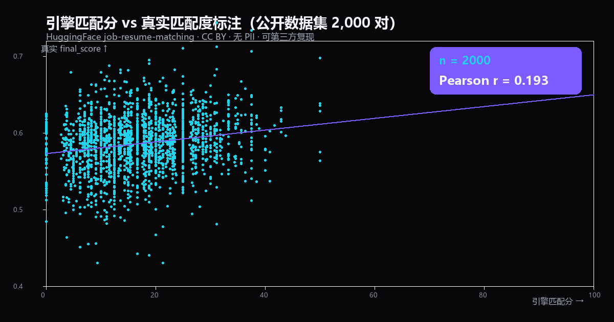

# 证据墙：匹配分如何被证伪

> career-loop 对外只讲一句话：**匹配分是可被证伪的**。
> 这份文档把这句话拆成**可复现的数字、可下载的公开数据、可自己重跑的脚本**。
> 不用相信作者，跑一遍就知道。

---

## 0. 先看结论（三个数字）

| 检验 | 结果 | 说明 |
|---|---|---|
| 岗位族识别（1,167 条真实 JD） | **91.9%** | 用公开数据集自带的 `category` 当 ground truth |
| 引擎匹配分 ↔ 真实匹配标注（2,000 对） | **Pearson r = 0.193** | 弱正相关，符合「规则基线 vs 多维语义标注」的预期 |
| 作者私有 40 条真实投递（已脱敏聚合） | **r = -0.255** | 关键词覆盖率**饱和**导致反向——故意保留，见第 3 节 |

前两个数字来自**公开数据集**，任何人有网就能复现（第 6 节给命令）。
第三个数字来自作者自己的求职记录，**只公开聚合统计，不含任何个人信息**（简历 / 公司名 / JD 原文都不在仓库里）。

---

## 1. 公开数据集检验（零 PII，可第三方复现）

### 数据来源

| 数据集 | 内容 | 规模 | 许可 |
|---|---|---|---|
| HuggingFace `nonameee12233/job-resume-matching`（`job.csv`） | 真实岗位 JD，含 `category` 标注 | 1,167 条 | CC BY 类 |
| 同上 `cv.csv` | 真实简历（`resume_text`） | 9,544 份 | 同上 |
| 同上 `matches.csv` | 候选×岗位真实匹配标注（`final_score`） | 122,560 对 | 同上 |

数据只保留在本地 `data/real_eval/`（已 gitignore），**不入库、不含 PII**；第三方用第 6 节脚本自行下载即可。

### 1.1 族识别准确率（1,167 条真实 JD）

用数据集自带的 `category` 作为正确答案，检验 `detect_domains()` 预测的岗位族是否落在该类对应的族集合内：

| 真实类别 | 准确率 | n |
|---|---:|---:|
| FINANCE | 96.6% | 236 |
| HR | 99.5% | 220 |
| BUSINESS-DEVELOPMENT | 100% | 239 |
| INFORMATION-TECHNOLOGY | 93.3% | 240 |
| SALES | 69.8% | 232 |
| **总体** | **91.9%** | **1,167** |

SALES 69.8% 是**已知短板**，原因写进报告了：通用软技能英文词（`performance management` / `training`）会跨族误判到 HR。没有藏。

**这个检验真的改过引擎**：AI 判定被 `sql` / `kpi` 这类通用业务词触发（大量非 AI 岗误判为 ai）、design 族 `ui`/`ux` 短词满屏误判、sales 族漏了真实职位词——三个 bug 都是**合成数据永远发现不了、只有真实数据才暴露**的，已修。

### 1.2 匹配分校准（2,000 真实配对）

用引擎对每个 (简历, JD) 配对算分，对照数据集自带的 `final_score`（多维语义匹配标注），算 Pearson r：



- **Pearson r = 0.193**（200 对 0.154 → 2,000 对 0.193，稳定弱正相关）
- 引擎分均值 **17.1**；真实 `final_score` 均值 0.586（被数据集压缩在 0.44–0.71 窄区间）
- 图上能直接看出：点云集中在低分区、趋势线**确实向上但很缓**——方向对，解释力有限。这就是「规则关键词基线」的真实水位，没有美化。

> 这张图**取代了**原来 29 条手写 demo 的 `r = 0.694`。后者按「分高就成功」编造，属于自证，已废弃。
> 本仓库不再用任何自证数据对外宣称准确率。

---

## 2. 闭环机制：任何人都能校准「自己的」分数

公开数据集只证明引擎「方向大致对」。真正回答「它对你准不准」，靠这条闭环：

```
① apply  投递时，工具按 JD × 你的经历算出预测匹配分 ──► 记进本地库
② log    你把真实结果回流：已读 / 沟通 / 面试 / offer / 拒绝
③ calibrate  用 Pearson r 检验「预测分 ↔ 真实结果」到底相不相关
```

- 只有 `沟通 / 感兴趣 / 初筛通过 / 面试邀约` 记为**正反馈**；单纯「已读 / 入库 / 待处理」不算。
- 样本到量后跑 `calibrate`，r 高就继续信这个分，r 低就**反过来用真实数据修权重**。
- 全过程在本地 SQLite，`data/calibration/` 已 gitignore——**你的求职数据永远不会上传**。

这就是 career-loop 和「一次性黑盒打分工具」的本质区别：它不只告诉你「你多匹配」，还允许你**用事实推翻它**。

---

## 3. 诚实的自我揭短（作者私有测试，已脱敏）

作者用自己的真实简历 × 40 条真实 JD 跑了同一条闭环（早期平台信号，非终局 offer/拒信）。
**只公开聚合数字，不含任何个人信息、公司名或 JD 原文；原始数据不在本仓库。**

| 指标 | 数值 |
|---|---|
| 投递数 | 40 |
| 正反馈（HR 沟通/感兴趣/初筛通过/面试邀约） | **7（17.5%）** |
| 匹配分 ↔ 真实互动 相关系数 | **r = -0.255（负相关）** |

分桶正反馈率：

| 预测匹配分档 | n | 正反馈率 |
|---|---:|---:|
| 40–60 | 4 | 50% |
| 60–80 | 7 | 14.3% |
| 80–100 | 29 | 13.8% |

**为什么公开一个「难看」的负相关？** 因为这恰恰是诚实性的证据：
- 根因是**关键词覆盖率在该候选人身上饱和**——简历覆盖了几乎所有 AI PM 要求，多数 JD 被算成 100%，区分度归零，高分段甚至反向。
- 如果作者想「做好看」，最简单就是把分数调成和结果强正相关。**保留 -0.255 说明这套分数不会被人为粉饰**：它如实暴露了自己的失效区间。
- 这直接回答了「可证伪」的含义：**一个能被真实数据打脸的分数，才值得你信它准的时候。**

同一批数据还给出一个真实求职信号（与分数无关、纯看平台动作）：7 条正反馈**全部集中在 AIGC / 创作者方向**，而大模型应用方向的投递零反响。这说明「先投哪个方向」这类决策，真实数据比任何打分都可靠。

---

## 4. 跨引擎一致性（Python ↔ 浏览器）

网页 Demo 用原生 JS 重写了同一套规则。两者必须同分，否则「可证伪」就是空话：

| 样例 | Python | 浏览器 |
|---|---:|---:|
| AI PM | 58.3% | 58.3% |
| Agent dev | 53.6% | 53.6% |
| Finance（会计岗） | 81.8% | 81.8% |

改规则必须两边一起改、并更新这张表（`scripts/sync_web_vocab.py --check` 在 CI 里卡漂移）。

---

## 5. 诚实边界（发布时必须保留）

1. 公开检验数据是**英文**；引擎中文主战场（65 族）的检验仍以内部 75 岗位检验集为主，真实英文数据作补充佐证。
2. `final_score` 是**另一个算法**（语义+技能+类别+经历+教育）标注的匹配度，**不是真人是否拿到面试**。
3. 第 3 节的私有测试是**早期平台信号**（HR 是否理你），不是终局录取；终局校准需等 offer/拒信回流后重跑。
4. 族识别 91.9% 只覆盖数据集里那 5 大类对应的族，不等于「全市场 91.9% 准」。

---

## 6. 复现清单（无需 API Key）

```bash
# 0) 拉公开数据集（约 250MB，来自 HuggingFace，不入库）
python scripts/fetch_real_eval_data.py

# 1) 族识别准确率（1,167 条真实 JD）→ 91.9%
python scripts/real_eval_family.py

# 2) 真实校准 r（2,000 配对）→ 0.193
python scripts/real_eval_calibrate.py --n 2000 --seed 7

# 3) 重新生成这张散点图 → docs/evidence-scatter.png
python scripts/real_eval_scatter.py --n 2000 --seed 7

# 4) 网页与引擎词表一致性检查
python scripts/sync_web_vocab.py --check
```

所有数字均来自确定性抽样（`seed=7`），第三方跑出来的应当一致；若不一致，欢迎开 issue 对账。

---

**一句话收尾**：career-loop 不承诺「匹配分 = 录取概率」。它承诺的是——**你随时可以用自己的真实结果，验证它到底准不准**。上面三个数字（91.9% / 0.193 / -0.255）就是这条承诺的兑现记录，包括它失效的地方。
